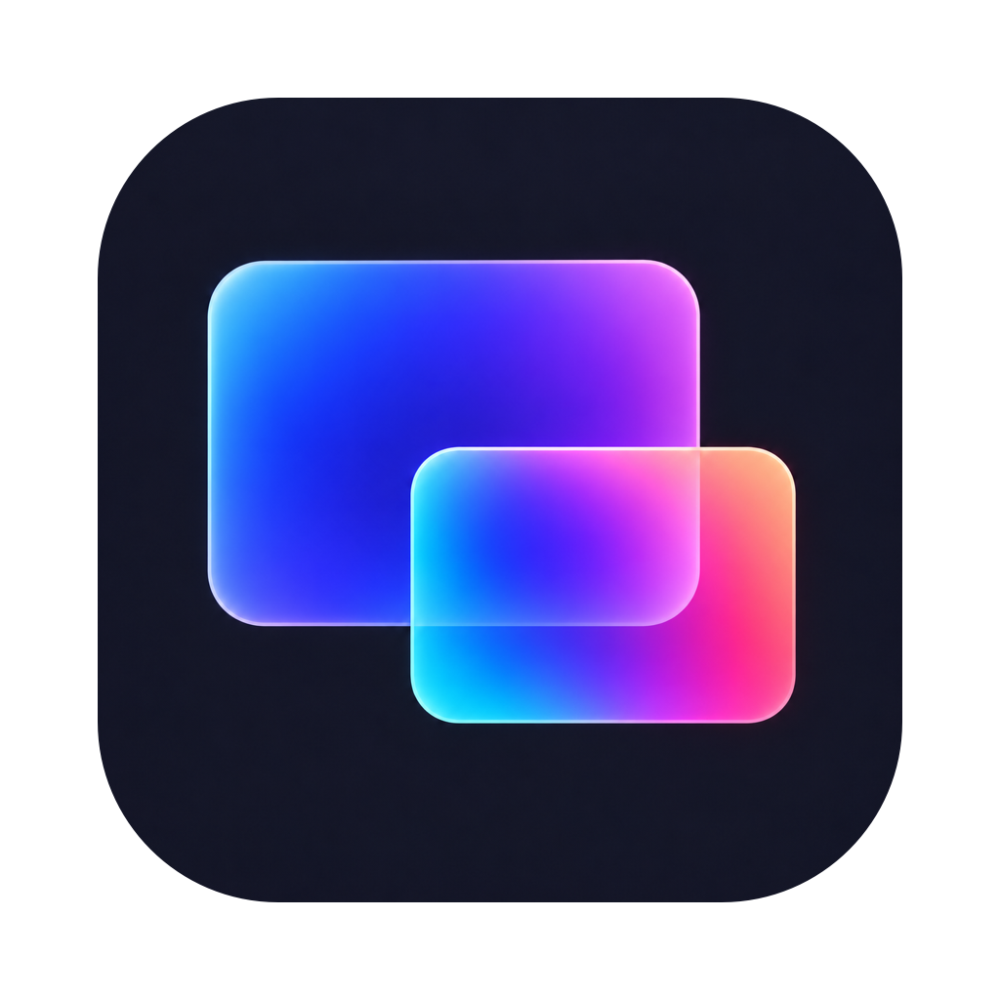
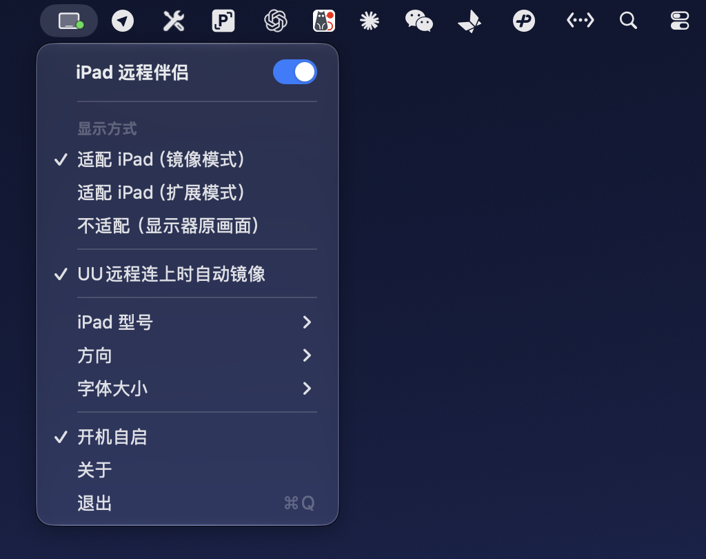

  

<h1 align="center">iPad 远程伴侣</h1>

为 Mac 创建适配 iPad 的虚拟屏幕，让远程桌面更清晰。

## 安装

适用于 **Apple 芯片 Mac，macOS 13 及以上**。

1. 在 Releases 页面下载安装包；<a href="https://github.com/aicent-studio/ipad-virtual-display/releases">下载软件</a>
2. 打开 DMG，将「iPad 远程伴侣」拖入「应用程序」。
3. 启动应用，在屏幕顶部菜单栏操作。

首次打开若被系统拦截，确认下载来源后，前往「系统设置 → 隐私与安全性」选择「仍要打开」。

## 使用

1. 点击菜单栏图标，打开开关
2. 选择 iPad 型号，一般勾选自动镜像+适配 iPad（镜像模式）即可
3. 保持「远程时自动镜像」开启，在 iPad 上通过网易 UU 远程连接后会自动镜像

## 构建

| 命令 | 说明 |
| --- | --- |
| `./build.sh` | 生成 `build/iPad 远程伴侣.app` |
| `./make-dmg.sh` | 生成安装包 `dist/iPad远程伴侣-<版本>.dmg` |
| `./build.sh --install` | 安装到 `/Applications` 并启动 |

## 代码结构

| 文件 | 作用 |
|---|---|
| `VirtualScreenAPI.h` | 系统创建虚拟显示器的接口声明 |
| `VirtualScreen.swift` | 一块虚拟屏：创建、登记分辨率 |
| `ScreenController.swift` | 按设置维护虚拟屏、镜像实体屏、睡眠唤醒后重建 |
| `DisplayConfig.swift` | 显示器配置读写工具 |
| `UURemoteWatcher.swift` | 检测 UU远程 是否在连接 |
| `IPadModels.swift` / `Settings.swift` | iPad 型号、显示大小与用户设置 |
| `LoginItem.swift` | 开机自启 |
| `AppDelegate.swift` | 菜单栏菜单与关于窗口 |

## 开源协议

[MIT](LICENSE) © 2026 GGBOY。本软件免费开源，请勿付费购买；问题反馈请提 [Issues](https://github.com/aicent-studio/ipad-virtual-display/issues)。
